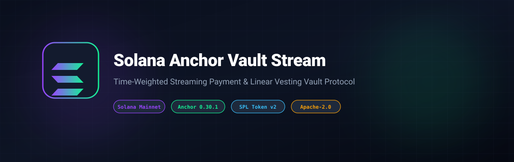

# Solana Anchor Vault Stream Protocol



[](LICENSE)
[](https://solana.com)
[](https://coral-xyz.github.io/anchor/)
[](https://www.typescriptlang.org/)

> **A high-performance Solana smart contract and TypeScript SDK for time-weighted continuous streaming payments and linear token vesting.**

---

## 🌟 Key Features

- **Continuous Per-Second Vesting**: Computes deterministic token entitlement mathematically based on clock timestamps with zero rounding loss.
- **Cliff Period Support**: Configurable cliff enforcement preventing early withdrawals before project milestones are achieved.
- **PDA Vault Security**: Non-custodial escrow vaults governed strictly by Anchor Seeds (`[b"stream", sender, stream_id]` & `[b"vault", stream]`).
- **Client SDK Included**: TypeScript SDK providing PDA derivation utilities, vesting simulators, and instruction builders.

---

## 🛠️ Instructions Specification

### 1. `initialize_stream`
Creates a stream escrow PDA and deposits SPL tokens into the program-controlled vault:
- `stream_id`: Unique sequence number per sender
- `total_amount`: Total SPL tokens locked in the stream
- `start_time`: Unix timestamp when vesting begins
- `end_time`: Unix timestamp when 100% of tokens are released
- `cliff_time`: Unix timestamp before which 0 tokens can be claimed

### 2. `withdraw`
Called by the designated recipient to claim unlocked vested tokens continuously.

---

## 🚀 Quick Start

### Build & Test TypeScript SDK

```bash
npm install
npm run test
npm run build
```

---

## 📄 License

Licensed under the Apache License, Version 2.0. See [LICENSE](LICENSE) for details.